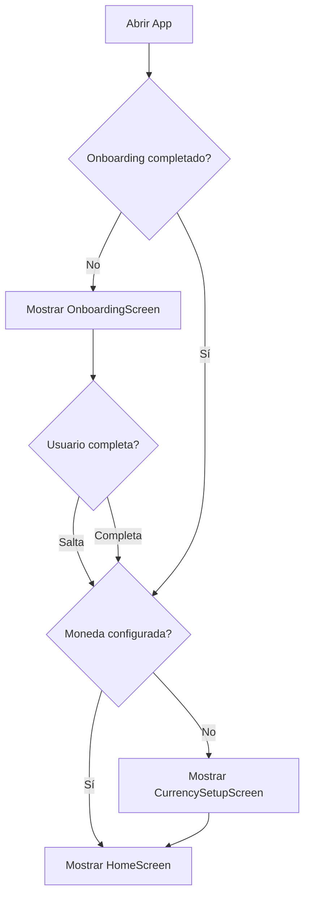
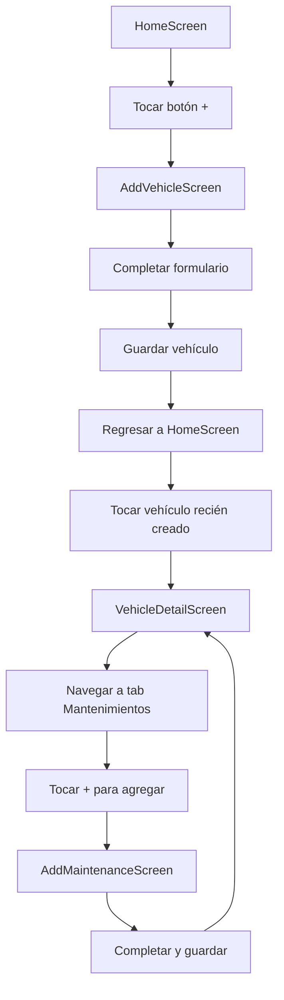
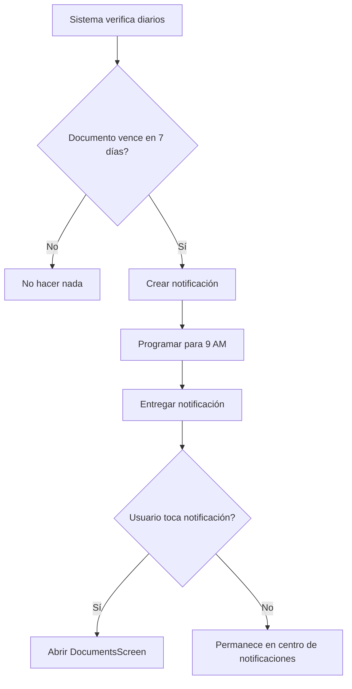

# Especificaciones Funcionales - Auto-Guardian

**Última actualización:** 2026-07-29  
**Versión:** 1.0.0

## Índice

1. [Alcance del Proyecto](#alcance-del-proyecto)
2. [Requisitos Funcionales](#requisitos-funcionales)
3. [Casos de Uso](#casos-de-uso)
4. [Especificaciones por Módulo](#especificaciones-por-módulo)
5. [Flujos de Usuario](#flujos-de-usuario)
6. [Reglas de Negocio](#reglas-de-negocio)
7. [Validaciones](#validaciones)
8. [Mensajes y Notificaciones](#mensajes-y-notificaciones)

---

## Alcance del Proyecto

### Objetivo General

Auto-Guardian es una aplicación móvil para la **gestión personal de vehículos**, enfocada en:

- Registro y seguimiento de vehículos personales
- Gestión de mantenimientos programados y correctivos
- Control de gastos e inversiones por vehículo
- Gestión de documentos con alertas de vencimiento
- Sistema de notificaciones preventivas
- Respaldo y recuperación de datos

### Usuarios Objetivo

- **Propietarios de vehículos personales** (1-5 vehículos)
- **Conductores que desean controlar gastos**
- **Usuarios preocupados por el mantenimiento preventivo**

### Alcance NO Incluido

- ❌ Gestión de flotas comerciales
- ❌ Integración con talleres mecánicos
- ❌ Sincronización multi-dispositivo
- ❌ Compartir vehículos entre usuarios
- ❌ Marketplace de repuestos/servicios
- ❌ Tracking GPS en tiempo real

---

## Requisitos Funcionales

### RF-001: Gestión de Vehículos

| ID       | Descripción                                | Prioridad |
| -------- | ------------------------------------------ | --------- |
| RF-001.1 | Registrar nuevo vehículo con datos básicos | Alta      |
| RF-001.2 | Editar información de vehículo existente   | Alta      |
| RF-001.3 | Eliminar vehículo (con confirmación)       | Alta      |
| RF-001.4 | Ver detalle completo de vehículo           | Alta      |
| RF-001.5 | Actualizar kilometraje actual              | Alta      |
| RF-001.6 | Agregar/cambiar foto de vehículo           | Media     |
| RF-001.7 | Visualizar historial de kilometraje        | Media     |
| RF-001.8 | Visualizar estadísticas del vehículo       | Baja      |

### RF-002: Gestión de Mantenimientos

| ID       | Descripción                                           | Prioridad |
| -------- | ----------------------------------------------------- | --------- |
| RF-002.1 | Registrar mantenimiento realizado                     | Alta      |
| RF-002.2 | Programar mantenimiento futuro                        | Alta      |
| RF-002.3 | Ver historial de mantenimientos por vehículo          | Alta      |
| RF-002.4 | Editar mantenimiento registrado                       | Media     |
| RF-002.5 | Eliminar mantenimiento                                | Media     |
| RF-002.6 | Marcar mantenimiento como completado                  | Alta      |
| RF-002.7 | Ver mantenimientos próximos (dashboard)               | Alta      |
| RF-002.8 | Configurar intervalos de mantenimiento personalizados | Media     |

### RF-003: Gestión de Reparaciones

| ID       | Descripción                           | Prioridad |
| -------- | ------------------------------------- | --------- |
| RF-003.1 | Registrar reparación realizada        | Alta      |
| RF-003.2 | Vincular reparación con mantenimiento | Media     |
| RF-003.3 | Ver historial de reparaciones         | Alta      |
| RF-003.4 | Editar/eliminar reparación            | Media     |
| RF-003.5 | Agregar notas detalladas a reparación | Media     |

### RF-004: Gestión de Gastos

| ID       | Descripción                                    | Prioridad |
| -------- | ---------------------------------------------- | --------- |
| RF-004.1 | Registrar gasto asociado a vehículo            | Alta      |
| RF-004.2 | Categorizar gastos (combustible, peajes, etc.) | Alta      |
| RF-004.3 | Ver resumen de gastos por vehículo             | Alta      |
| RF-004.4 | Ver resumen de gastos por período              | Media     |
| RF-004.5 | Calcular inversión total en vehículo           | Alta      |
| RF-004.6 | Exportar reporte de gastos                     | Baja      |

### RF-005: Gestión de Documentos

| ID       | Descripción                                     | Prioridad |
| -------- | ----------------------------------------------- | --------- |
| RF-005.1 | Agregar documento al vehículo                   | Alta      |
| RF-005.2 | Configurar fecha de vencimiento                 | Alta      |
| RF-005.3 | Ver documentos por vehículo                     | Alta      |
| RF-005.4 | Recibir alertas de documentos próximos a vencer | Alta      |
| RF-005.5 | Adjuntar archivo/foto al documento              | Media     |
| RF-005.6 | Editar/eliminar documento                       | Media     |
| RF-005.7 | Configurar tipos de documentos personalizados   | Baja      |

### RF-006: Sistema de Notificaciones

| ID       | Descripción                                       | Prioridad |
| -------- | ------------------------------------------------- | --------- |
| RF-006.1 | Recibir notificaciones de mantenimientos próximos | Alta      |
| RF-006.2 | Recibir notificaciones de documentos por vencer   | Alta      |
| RF-006.3 | Configurar hora de notificaciones diarias         | Media     |
| RF-006.4 | Activar/desactivar notificaciones por tipo        | Media     |
| RF-006.5 | Ver resumen de alertas pendientes                 | Alta      |
| RF-006.6 | Configurar anticipación de alertas (días previos) | Media     |

### RF-007: Gestión de Contactos

| ID       | Descripción                                    | Prioridad |
| -------- | ---------------------------------------------- | --------- |
| RF-007.1 | Agregar contacto (mecánico, aseguradora, etc.) | Media     |
| RF-007.2 | Editar información de contacto                 | Media     |
| RF-007.3 | Eliminar contacto                              | Media     |
| RF-007.4 | Llamar directamente desde la app               | Baja      |
| RF-007.5 | Categorizar contactos por tipo                 | Baja      |

### RF-008: Configuración y Preferencias

| ID       | Descripción                                      | Prioridad |
| -------- | ------------------------------------------------ | --------- |
| RF-008.1 | Configurar moneda preferida (primera vez)        | Alta      |
| RF-008.2 | Cambiar moneda en cualquier momento              | Media     |
| RF-008.3 | Alternar entre tema claro/oscuro                 | Media     |
| RF-008.4 | Gestionar tipos de mantenimiento predeterminados | Media     |
| RF-008.5 | Gestionar tipos de documento predeterminados     | Media     |
| RF-008.6 | Ver información "Acerca de" la app               | Baja      |

### RF-009: Respaldo y Recuperación

| ID       | Descripción                                      | Prioridad |
| -------- | ------------------------------------------------ | --------- |
| RF-009.1 | Exportar respaldo completo (JSON)                | Alta      |
| RF-009.2 | Importar respaldo desde archivo                  | Alta      |
| RF-009.3 | Compartir archivo de respaldo vía sistema        | Alta      |
| RF-009.4 | Validar integridad de respaldo antes de importar | Alta      |
| RF-009.5 | Confirmar reemplazo de datos al importar         | Alta      |

### RF-010: Onboarding y Tutoriales

| ID       | Descripción                            | Prioridad |
| -------- | -------------------------------------- | --------- |
| RF-010.1 | Mostrar onboarding a nuevos usuarios   | Alta      |
| RF-010.2 | Permitir saltar onboarding             | Media     |
| RF-010.3 | Mostrar tips contextuales en pantallas | Baja      |
| RF-010.4 | Proveer sección de "Aprende más"       | Baja      |

---

## Casos de Uso

### CU-001: Registrar un Nuevo Vehículo

**Actor principal**: Usuario  
**Precondiciones**: App instalada y abierta  
**Flujo principal**:

1. Usuario navega a pantalla principal (Home)
2. Usuario toca botón "Agregar Vehículo" (+)
3. Sistema muestra formulario de registro
4. Usuario ingresa datos obligatorios:
   - Marca
   - Modelo
   - Año
5. Usuario ingresa datos opcionales:
   - Placa
   - VIN
   - Color
   - Tipo de combustible
   - Tipo de transmisión
   - Kilometraje actual
   - Fecha de compra
   - Precio de compra
6. Usuario opcionalmente agrega foto del vehículo
7. Usuario toca "Guardar"
8. Sistema valida datos
9. Sistema guarda vehículo en base de datos
10. Sistema navega de regreso a pantalla principal
11. Sistema muestra vehículo en lista

**Flujos alternativos**:

- **4a. Usuario omite datos obligatorios**:
  - Sistema muestra mensaje de error
  - Sistema resalta campos faltantes
  - Flujo continúa en paso 4

- **7a. Usuario toca "Cancelar"**:
  - Sistema descarta datos
  - Sistema regresa a pantalla principal

**Postcondiciones**: Vehículo guardado y visible en lista

---

### CU-002: Registrar Mantenimiento Realizado

**Actor principal**: Usuario  
**Precondiciones**: Al menos un vehículo registrado  
**Flujo principal**:

1. Usuario navega a pantalla de Mantenimiento
2. Usuario toca botón "Agregar Mantenimiento" (+)
3. Sistema muestra formulario
4. Usuario selecciona vehículo (si tiene múltiples)
5. Usuario selecciona tipo de mantenimiento de lista predefinida
6. Usuario ingresa:
   - Fecha de realización
   - Kilometraje al momento del servicio
   - Costo
   - Notas (opcional)
7. Usuario opcionalmente programa próximo mantenimiento:
   - Próximo km recomendado
   - Próxima fecha recomendada
8. Usuario toca "Guardar"
9. Sistema valida datos
10. Sistema guarda mantenimiento
11. Sistema actualiza alertas si se programó próximo mantenimiento
12. Sistema regresa a historial de mantenimientos

**Flujos alternativos**:

- **5a. Usuario quiere agregar tipo personalizado**:
  - Usuario navega a Configuración → Tipos de Mantenimiento
  - Usuario agrega nuevo tipo
  - Flujo regresa a paso 5

**Postcondiciones**: Mantenimiento guardado, alertas actualizadas

---

### CU-003: Recibir Alerta de Documento por Vencer

**Actor principal**: Sistema  
**Precondiciones**:

- Usuario tiene documentos registrados con fecha de vencimiento
- Usuario tiene notificaciones activadas

**Flujo principal**:

1. Sistema ejecuta verificación diaria (hora configurada)
2. Sistema consulta documentos próximos a vencer (dentro de N días configurados)
3. Sistema encuentra documento que vence en 7 días
4. Sistema crea notificación local:
   - Título: "Documento por vencer"
   - Mensaje: "[Tipo documento] de [Marca Modelo] vence en 7 días"
5. Sistema programa notificación para hora configurada
6. Sistema entrega notificación al usuario
7. Usuario toca notificación
8. Sistema abre pantalla de Documentos
9. Sistema resalta documento próximo a vencer

**Flujos alternativos**:

- **3a. No hay documentos por vencer**:
  - Sistema no crea notificación
  - Flujo termina

- **6a. Usuario tiene notificaciones desactivadas**:
  - Sistema no entrega notificación
  - Alerta visible solo dentro de la app

**Postcondiciones**: Usuario notificado de documento próximo a vencer

---

### CU-004: Exportar Respaldo de Datos

**Actor principal**: Usuario  
**Precondiciones**: Usuario tiene datos registrados  
**Flujo principal**:

1. Usuario navega a Más → Configuración → Gestión de datos
2. Usuario toca "Exportar datos"
3. Sistema recopila todos los datos de SQLite:
   - Vehículos
   - Mantenimientos
   - Gastos
   - Documentos
   - Contactos
   - Configuración
4. Sistema serializa datos a formato JSON
5. Sistema agrega metadata:
   - Timestamp de exportación
   - Versión de app
   - Identificador de app
6. Sistema guarda archivo en sistema de archivos local
7. Sistema muestra diálogo de compartir del sistema operativo
8. Usuario selecciona destino (Drive, Dropbox, Email, etc.)
9. Sistema comparte archivo
10. Sistema muestra mensaje de éxito

**Flujos alternativos**:

- **7a. Usuario cancela compartir**:
  - Sistema mantiene archivo en almacenamiento local
  - Sistema informa ubicación del archivo

- **9a. Error al compartir**:
  - Sistema muestra mensaje de error
  - Sistema mantiene archivo localmente

**Postcondiciones**: Respaldo creado y compartido

---

### CU-005: Importar Respaldo de Datos

**Actor principal**: Usuario  
**Precondiciones**: Usuario tiene archivo de respaldo previo  
**Flujo principal**:

1. Usuario navega a Más → Configuración → Gestión de datos
2. Usuario toca "Importar datos"
3. Sistema abre selector de archivos del sistema
4. Usuario selecciona archivo de respaldo
5. Sistema lee y valida archivo:
   - Verifica formato JSON válido
   - Verifica metadata de app
   - Verifica estructura de datos
6. Sistema muestra diálogo de confirmación:
   - "⚠️ Esto reemplazará TODOS tus datos actuales"
   - Botones: "Cancelar" | "Confirmar"
7. Usuario toca "Confirmar"
8. Sistema inicia transacción de base de datos
9. Sistema elimina todos los datos actuales
10. Sistema inserta datos desde respaldo
11. Sistema confirma transacción
12. Sistema recarga contextos globales
13. Sistema muestra mensaje de éxito
14. Sistema regresa a pantalla principal

**Flujos alternativos**:

- **5a. Archivo inválido**:
  - Sistema muestra error: "Este no es un respaldo válido de Auto Guardian"
  - Flujo termina

- **7a. Usuario cancela**:
  - Sistema no modifica datos
  - Flujo termina

- **11a. Error en importación**:
  - Sistema revierte transacción (rollback)
  - Sistema mantiene datos originales
  - Sistema muestra mensaje de error

**Postcondiciones**: Datos restaurados desde respaldo

---

## Especificaciones por Módulo

### Módulo: HomeScreen

**Propósito**: Dashboard principal con vista general de vehículos

**Elementos de UI**:

- Lista de vehículos (FlatList)
- Tarjeta por vehículo con:
  - Foto o ícono placeholder
  - Marca y modelo
  - Año
  - Kilometraje actual
  - Próximo mantenimiento (si existe)
- Botón flotante "+" para agregar vehículo
- Empty state cuando no hay vehículos

**Interacciones**:

- Tocar tarjeta → Navega a VehicleDetailScreen
- Tocar "+" → Navega a AddVehicleScreen
- Pull-to-refresh → Recarga lista de vehículos

**Lógica**:

```javascript
// Cargar vehículos al montar componente
useEffect(() => {
  loadVehicles();
}, []);

// Recargar al enfocar pantalla (regreso desde otras pantallas)
useFocusEffect(
  useCallback(() => {
    loadVehicles();
  }, []),
);
```

---

### Módulo: VehicleDetailScreen

**Propósito**: Vista detallada de un vehículo específico

**Elementos de UI**:

- Header con foto grande de vehículo
- Sección de datos básicos
- Tabs:
  - **Información**: Datos del vehículo
  - **Mantenimientos**: Historial reciente
  - **Gastos**: Resumen de inversión
  - **Documentos**: Documentos asociados
- Botones de acción:
  - Actualizar km
  - Editar vehículo
  - Eliminar vehículo

**Reglas de negocio**:

- Kilometraje solo puede incrementarse (no disminuir)
- Al eliminar vehículo, eliminar en cascada:
  - Todos los mantenimientos
  - Todos los gastos
  - Todos los documentos asociados
- Confirmación obligatoria antes de eliminar

---

### Módulo: MaintenanceHistoryScreen

**Propósito**: Historial completo de mantenimientos

**Elementos de UI**:

- Filtros:
  - Por vehículo (si hay múltiples)
  - Por tipo de mantenimiento
  - Por rango de fechas
- Lista agrupada por mes
- Tarjeta por mantenimiento con:
  - Tipo de mantenimiento
  - Vehículo
  - Fecha y km
  - Costo
  - Estado (completado/pendiente)
- Botón "+" para agregar mantenimiento

**Cálculos**:

- Total gastado en mantenimientos
- Promedio de costo por tipo
- Frecuencia de mantenimientos

---

### Módulo: DocumentsScreen

**Propósito**: Gestión centralizada de documentos

**Elementos de UI**:

- Lista de documentos de todos los vehículos
- Indicador visual de estado:
  - 🟢 Verde: Vigente (más de 30 días)
  - 🟡 Amarillo: Próximo a vencer (7-30 días)
  - 🔴 Rojo: Vencido o por vencer (menos de 7 días)
- Tarjeta por documento con:
  - Tipo de documento
  - Vehículo asociado
  - Fecha de vencimiento
  - Archivo adjunto (si existe)

**Reglas de negocio**:

- Documentos sin fecha de vencimiento se muestran con estado neutral
- Ordenar por fecha de vencimiento (más próximos primero)
- Permitir filtrar por vehículo

---

### Módulo: NotificationsScreen

**Propósito**: Centro de alertas y configuración

**Elementos de UI**:

- Resumen de alertas activas:
  - Mantenimientos próximos
  - Documentos por vencer
- Configuración de notificaciones:
  - Hora de notificación diaria
  - Días de anticipación para alertas
  - Activar/desactivar por tipo
- Historial de notificaciones recientes

**Configuración predeterminada**:

- Hora: 9:00 AM
- Anticipación documentos: 7 días
- Anticipación mantenimientos: 500 km o 7 días
- Todas las notificaciones activadas por defecto

---

### Módulo: StatsScreen

**Propósito**: Estadísticas y análisis de datos

**Elementos de UI**:

- Selector de vehículo (si múltiples)
- Gráficos:
  - Gastos por mes (barras)
  - Distribución por categoría (torta)
  - Evolución de kilometraje (línea)
- KPIs:
  - Gasto total
  - Gasto promedio mensual
  - Km recorridos (último mes/año)
  - Costo por km

**Cálculos**:

```javascript
// Costo por kilómetro
const costoKm = gastoTotal / (kmActual - kmInicial);

// Gasto promedio mensual
const promedioMensual = gastoTotal / mesesDeUso;
```

---

### Módulo: DataManagementScreen

**Propósito**: Respaldo y restauración de datos

**Elementos de UI**:

- Sección "Exportar datos":
  - Descripción del proceso
  - Botón "Exportar"
  - Última exportación (timestamp)
- Sección "Importar datos":
  - Advertencia sobre reemplazo de datos
  - Botón "Importar"
- Recomendación de almacenamiento en nube

**Formato de archivo**:

```
autoguardian_backup_YYYYMMDD_HHMMSS.json
```

**Validaciones de importación**:

1. Archivo es JSON válido
2. Tiene campo `app: "Auto Guardian"`
3. Tiene campo `version` compatible
4. Tiene estructura `tables` con arrays válidos

---

## Flujos de Usuario

### Flujo: Primera Apertura de la App



### Flujo: Agregar Vehículo y Primer Mantenimiento



### Flujo: Notificación de Documento por Vencer



---

## Reglas de Negocio

### RN-001: Kilometraje

- El kilometraje de un vehículo **solo puede incrementarse**, nunca disminuir
- Al registrar mantenimiento, el km ingresado debe ser ≥ km actual del vehículo
- Si km de mantenimiento > km actual del vehículo, actualizar km actual del vehículo

### RN-002: Cálculo de Próximo Mantenimiento

**Por kilometraje**:

```
próximo_km = km_mantenimiento + intervalo_km
```

**Por tiempo**:

```
próxima_fecha = fecha_mantenimiento + intervalo_meses
```

**Criterio de alerta**:

- Mostrar alerta si: `km_actual >= (próximo_km - 500)` **O** `fecha_actual >= (próxima_fecha - 7 días)`

### RN-003: Eliminación en Cascada

Al eliminar un vehículo, eliminar automáticamente:

- Todos sus mantenimientos
- Todos sus gastos
- Todos sus documentos
- Todas sus notificaciones programadas asociadas

**Implementación**:

```sql
FOREIGN KEY (vehicleId) REFERENCES vehicles(id) ON DELETE CASCADE
```

### RN-004: Validación de Respaldo

Un archivo es respaldo válido si:

1. Es JSON parseable
2. Tiene `app === "Auto Guardian"`
3. Tiene `version` (string)
4. Tiene `tables` (object)
5. Cada tabla tiene `tableName` y `rows` (array)

### RN-005: Cálculo de Inversión Total

```javascript
inversión_total =
  precio_compra + Σ(gastos) + Σ(mantenimientos) + Σ(reparaciones);
```

Mostrar como "Inversión acumulada" en VehicleDetailScreen.

### RN-006: Estados de Documento

| Estado      | Condición                   | Color    | Acción                 |
| ----------- | --------------------------- | -------- | ---------------------- |
| **Vigente** | `días_restantes > 30`       | Verde    | Sin acción             |
| **Próximo** | `7 <= días_restantes <= 30` | Amarillo | Notificar 7 días antes |
| **Urgente** | `0 < días_restantes < 7`    | Rojo     | Notificar diariamente  |
| **Vencido** | `días_restantes <= 0`       | Rojo     | Notificar diariamente  |

### RN-007: Moneda

- Usuario debe configurar moneda **antes** de usar la app
- Cambiar moneda **NO** convierte valores existentes, solo cambia el símbolo mostrado
- Monedas soportadas: Lista predefinida con símbolos Unicode

---

## Validaciones

### Formulario: Agregar Vehículo

| Campo             | Validación                                    | Mensaje de Error                    |
| ----------------- | --------------------------------------------- | ----------------------------------- |
| **Marca**         | Requerido, min 1 carácter                     | "La marca es obligatoria"           |
| **Modelo**        | Requerido, min 1 carácter                     | "El modelo es obligatorio"          |
| **Año**           | Requerido, número entre 1900 y año actual + 1 | "Año inválido"                      |
| **Placa**         | Opcional, formato alfanumérico                | -                                   |
| **VIN**           | Opcional, 17 caracteres alfanuméricos         | "VIN debe tener 17 caracteres"      |
| **Kilometraje**   | Opcional, número >= 0                         | "Kilometraje no puede ser negativo" |
| **Precio compra** | Opcional, número >= 0                         | "Precio no puede ser negativo"      |
| **Fecha compra**  | Opcional, fecha <= hoy                        | "La fecha no puede ser futura"      |

### Formulario: Agregar Mantenimiento

| Campo             | Validación                          | Mensaje de Error                                  |
| ----------------- | ----------------------------------- | ------------------------------------------------- |
| **Vehículo**      | Requerido (selección)               | "Selecciona un vehículo"                          |
| **Tipo**          | Requerido (selección)               | "Selecciona tipo de mantenimiento"                |
| **Fecha**         | Requerido, fecha <= hoy             | "La fecha no puede ser futura"                    |
| **Kilometraje**   | Opcional, >= km actual del vehículo | "El kilometraje debe ser mayor o igual al actual" |
| **Costo**         | Opcional, número >= 0               | "El costo no puede ser negativo"                  |
| **Próximo km**    | Opcional, > km actual               | "Debe ser mayor al kilometraje actual"            |
| **Próxima fecha** | Opcional, > hoy                     | "Debe ser una fecha futura"                       |

### Formulario: Agregar Gasto

| Campo           | Validación              | Mensaje de Error               |
| --------------- | ----------------------- | ------------------------------ |
| **Vehículo**    | Requerido               | "Selecciona un vehículo"       |
| **Tipo**        | Requerido               | "Selecciona tipo de gasto"     |
| **Monto**       | Requerido, número > 0   | "El monto debe ser mayor a 0"  |
| **Fecha**       | Requerido, fecha <= hoy | "La fecha no puede ser futura" |
| **Descripción** | Opcional                | -                              |

### Formulario: Agregar Documento

| Campo                 | Validación            | Mensaje de Error               |
| --------------------- | --------------------- | ------------------------------ |
| **Vehículo**          | Requerido             | "Selecciona un vehículo"       |
| **Tipo**              | Requerido             | "Selecciona tipo de documento" |
| **Fecha vencimiento** | Opcional, fecha > hoy | "La fecha debe ser futura"     |
| **Archivo**           | Opcional              | -                              |

---

## Mensajes y Notificaciones

### Notificaciones Push Locales

#### Mantenimiento Próximo (por km)

```
Título: Mantenimiento próximo
Cuerpo: [Tipo mantenimiento] de [Marca Modelo] en 500 km
```

#### Mantenimiento Próximo (por fecha)

```
Título: Mantenimiento próximo
Cuerpo: [Tipo mantenimiento] de [Marca Modelo] en 7 días
```

#### Documento por Vencer

```
Título: Documento por vencer
Cuerpo: [Tipo documento] de [Marca Modelo] vence en [N] días
```

#### Documento Vencido

```
Título: Documento vencido
Cuerpo: [Tipo documento] de [Marca Modelo] está vencido
```

### Mensajes de Confirmación

#### Eliminar Vehículo

```
⚠️ ¿Eliminar vehículo?

Esto eliminará permanentemente:
• Todos los mantenimientos
• Todos los gastos
• Todos los documentos

Esta acción no se puede deshacer.

[Cancelar] [Eliminar]
```

#### Importar Respaldo

```
⚠️ Reemplazar todos los datos

Esto eliminará TODOS tus datos actuales y los reemplazará con los del respaldo.

Se recomienda exportar tus datos actuales antes de continuar.

[Cancelar] [Confirmar]
```

#### Eliminar Mantenimiento

```
¿Eliminar este mantenimiento?

Esta acción no se puede deshacer.

[Cancelar] [Eliminar]
```

### Mensajes de Éxito

```
✅ Vehículo agregado correctamente
✅ Mantenimiento registrado
✅ Documento guardado
✅ Respaldo exportado exitosamente
✅ Datos importados correctamente
✅ Configuración actualizada
```

### Mensajes de Error

```
❌ Error al guardar el vehículo
❌ No se pudo cargar el archivo
❌ El respaldo no es válido
❌ Error al exportar datos
❌ No se pudo programar la notificación
❌ Error de base de datos
```

### Empty States

#### Sin Vehículos

```
🚗 No tienes vehículos registrados

Agrega tu primer vehículo para comenzar a gestionar
su mantenimiento y gastos.

[Agregar Vehículo]
```

#### Sin Mantenimientos

```
🔧 Sin mantenimientos registrados

Registra los mantenimientos de tus vehículos para
llevar un control preciso.

[Agregar Mantenimiento]
```

#### Sin Documentos

```
📄 Sin documentos registrados

Agrega documentos como seguro, revisión técnica, etc.
para recibir alertas de vencimiento.

[Agregar Documento]
```

#### Sin Gastos

```
💰 Sin gastos registrados

Registra los gastos de tus vehículos para analizar
tu inversión.

[Agregar Gasto]
```

---

## Anexos

### A. Tipos de Mantenimiento Predeterminados

1. Cambio de aceite (Motor)
2. Filtro de aceite (Motor)
3. Filtro de aire (Motor)
4. Bujías (Motor)
5. Pastillas de freno (Frenos)
6. Líquido de frenos (Frenos)
7. Rotación de neumáticos (Neumáticos)
8. Alineación (Neumáticos)
9. Batería (Eléctrico)
10. Correa de distribución (Motor)

### B. Tipos de Documento Predeterminados

1. Seguro
2. Revisión técnica
3. Permiso de circulación
4. Tarjeta de propiedad
5. Licencia de conducir (asociada al conductor)
6. Garantía
7. Inspección vehicular

### C. Categorías de Gastos

1. Combustible
2. Mantenimiento
3. Reparación
4. Seguros
5. Peajes
6. Estacionamiento
7. Multas
8. Limpieza
9. Accesorios
10. Otros

---

**Última revisión**: 2026-07-29  
**Versión del documento**: 1.0.0  
**Aprobado por**: Equipo de Desarrollo Auto-Guardian
