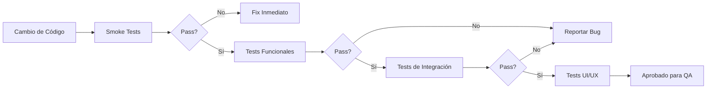

# Plan de Tests de Regresión - Auto-Guardian

**Última actualización:** 2026-07-29  
**Versión:** 1.0.0

## Índice

1. [Introducción](#introducción)
2. [Alcance de Tests](#alcance-de-tests)
3. [Estrategia de Testing](#estrategia-de-testing)
4. [Tests Funcionales](#tests-funcionales)
5. [Tests de Integración](#tests-de-integración)
6. [Tests de UI/UX](#tests-de-uiux)
7. [Tests de Rendimiento](#tests-de-rendimiento)
8. [Tests de Compatibilidad](#tests-de-compatibilidad)
9. [Checklist de Regresión](#checklist-de-regresión)
10. [Casos de Prueba Críticos](#casos-de-prueba-críticos)
11. [Escenarios de Edge Cases](#escenarios-de-edge-cases)
12. [Plan de Automatización](#plan-de-automatización)

---

## Introducción

Este documento define el **plan de tests de regresión** para Auto-Guardian, asegurando que las funcionalidades existentes continúen operando correctamente después de cambios en el código.

### Objetivos

- ✅ Verificar que funcionalidades principales no se rompan con nuevos cambios
- ✅ Detectar bugs introducidos en actualizaciones
- ✅ Validar flujos críticos de usuario
- ✅ Asegurar compatibilidad entre versiones
- ✅ Garantizar integridad de datos

### Tipos de Tests

| Tipo               | Propósito                           | Frecuencia         |
| ------------------ | ----------------------------------- | ------------------ |
| **Smoke Tests**    | Verificar funcionalidad básica      | Cada build         |
| **Funcionales**    | Validar requisitos funcionales      | Cada release       |
| **Integración**    | Verificar interacción entre módulos | Cada sprint        |
| **UI/UX**          | Validar experiencia de usuario      | Cada release       |
| **Rendimiento**    | Detectar degradación de performance | Mensual            |
| **Compatibilidad** | Validar múltiples dispositivos/OS   | Cada release mayor |

---

## Alcance de Tests

### Módulos en Alcance

| Módulo                    | Prioridad | Cobertura Objetivo |
| ------------------------- | --------- | ------------------ |
| **Gestión de Vehículos**  | Crítica   | 95%                |
| **Mantenimientos**        | Crítica   | 95%                |
| **Gastos**                | Alta      | 85%                |
| **Documentos**            | Alta      | 85%                |
| **Notificaciones**        | Alta      | 80%                |
| **Respaldo/Restauración** | Crítica   | 95%                |
| **Configuración**         | Media     | 70%                |
| **Estadísticas**          | Media     | 70%                |
| **Contactos**             | Baja      | 60%                |

### Funcionalidades Críticas

Estas funcionalidades DEBEN testearse en cada ciclo de regresión:

1. ✅ Agregar/Editar/Eliminar Vehículo
2. ✅ Registrar Mantenimiento
3. ✅ Actualizar Kilometraje
4. ✅ Agregar Documento con fecha de vencimiento
5. ✅ Exportar/Importar Respaldo
6. ✅ Programar Notificaciones
7. ✅ Configurar Moneda (primer uso)
8. ✅ Navegación entre pantallas principales

---

## Estrategia de Testing

### Niveles de Testing

```
┌─────────────────────────────────────┐
│     Tests E2E (Detox)              │  ← Flujos completos de usuario
├─────────────────────────────────────┤
│     Tests de Integración           │  ← Interacción entre servicios
├─────────────────────────────────────┤
│     Tests Unitarios (Jest)         │  ← Funciones individuales
└─────────────────────────────────────┘
```

### Criterios de Aceptación

Un build pasa regresión si:

- ✅ 100% de tests críticos pasan
- ✅ ≥ 95% de tests funcionales pasan
- ✅ 0 bugs de severidad alta/crítica
- ✅ Performance dentro de SLA (ver sección Rendimiento)
- ✅ Sin regresiones de UI críticas

### Proceso de Testing



---

## Tests Funcionales

### TF-001: Gestión de Vehículos

#### TF-001.1: Agregar Vehículo Exitoso

**Precondiciones**: App abierta, usuario en HomeScreen

**Pasos**:

1. Tocar botón "Agregar Vehículo" (+)
2. Ingresar datos obligatorios:
   - Marca: "Toyota"
   - Modelo: "Corolla"
   - Año: "2020"
3. Ingresar datos opcionales:
   - Placa: "ABC123"
   - Kilometraje: "15000"
4. Tocar "Guardar"

**Resultado esperado**:

- ✅ Navegación regresa a HomeScreen
- ✅ Vehículo aparece en la lista
- ✅ Datos mostrados coinciden con ingresados
- ✅ Registro guardado en SQLite

**Datos de prueba**:

```json
{
  "brand": "Toyota",
  "model": "Corolla",
  "year": 2020,
  "licensePlate": "ABC123",
  "currentKm": 15000
}
```

---

#### TF-001.2: Validación de Campos Obligatorios

**Precondiciones**: Formulario de agregar vehículo abierto

**Pasos**:

1. Dejar campos obligatorios vacíos
2. Tocar "Guardar"

**Resultado esperado**:

- ✅ Formulario NO se envía
- ✅ Mensaje de error visible
- ✅ Campos obligatorios resaltados
- ✅ Usuario permanece en formulario

---

#### TF-001.3: Editar Vehículo

**Precondiciones**: Al menos un vehículo existente

**Pasos**:

1. Navegar a VehicleDetailScreen
2. Tocar botón "Editar"
3. Modificar campo "Modelo" de "Corolla" a "Camry"
4. Tocar "Guardar"

**Resultado esperado**:

- ✅ Cambios guardados en DB
- ✅ UI actualizada con nuevo valor
- ✅ Timestamp `updatedAt` actualizado

---

#### TF-001.4: Eliminar Vehículo

**Precondiciones**: Al menos un vehículo existente con:

- 2 mantenimientos
- 3 gastos
- 1 documento

**Pasos**:

1. Navegar a VehicleDetailScreen
2. Tocar "Eliminar"
3. Confirmar en diálogo

**Resultado esperado**:

- ✅ Vehículo eliminado de DB
- ✅ Todos los mantenimientos eliminados (CASCADE)
- ✅ Todos los gastos eliminados (CASCADE)
- ✅ Todos los documentos eliminados (CASCADE)
- ✅ Navegación regresa a HomeScreen
- ✅ Vehículo NO aparece en lista

**Query de verificación**:

```sql
SELECT COUNT(*) FROM maintenances WHERE vehicleId = [deleted_id];
-- Resultado esperado: 0
```

---

#### TF-001.5: Actualizar Kilometraje

**Precondiciones**: Vehículo con km actual = 15000

**Pasos**:

1. Navegar a VehicleDetailScreen
2. Tocar "Actualizar km"
3. Ingresar nuevo km: "15500"
4. Confirmar

**Resultado esperado**:

- ✅ Kilometraje actualizado en DB
- ✅ UI muestra nuevo valor
- ✅ Si hay mantenimientos pendientes cerca, actualizar alertas

**Caso negativo**:

- Ingresar km = "14000" (menor al actual)
- Resultado: ❌ Mostrar error "El kilometraje no puede disminuir"

---

### TF-002: Gestión de Mantenimientos

#### TF-002.1: Registrar Mantenimiento con Programación

**Precondiciones**: Vehículo existente con km = 20000

**Pasos**:

1. Navegar a MaintenanceHistoryScreen
2. Tocar "Agregar Mantenimiento"
3. Seleccionar vehículo
4. Seleccionar tipo: "Cambio de aceite"
5. Ingresar:
   - Fecha: Hoy
   - Km: "20000"
   - Costo: "50.00"
6. Programar próximo:
   - Próximo km: "25000"
   - Próxima fecha: Hoy + 6 meses
7. Guardar

**Resultado esperado**:

- ✅ Mantenimiento guardado en DB
- ✅ Notificación programada para km = 24500 (500 km antes)
- ✅ Notificación programada para fecha - 7 días
- ✅ Aparece en HomeScreen bajo "Próximos mantenimientos"

**Verificación de notificación**:

```javascript
const notifications = await Notifications.getAllScheduledNotificationsAsync();
// Verificar que existen 2 notificaciones para este mantenimiento
```

---

#### TF-002.2: Actualizar km del Vehículo Automáticamente

**Precondiciones**:

- Vehículo con km actual = 15000
- Registrar mantenimiento con km = 16000

**Resultado esperado**:

- ✅ km del vehículo actualizado automáticamente a 16000

---

#### TF-002.3: Marcar Mantenimiento como Completado

**Precondiciones**: Mantenimiento pendiente registrado

**Pasos**:

1. Navegar a MaintenanceHistoryScreen
2. Tocar mantenimiento pendiente
3. Marcar como completado

**Resultado esperado**:

- ✅ Campo `completed` = 1 en DB
- ✅ Indicador visual actualizado
- ✅ Removido de "Próximos mantenimientos"

---

### TF-003: Gestión de Gastos

#### TF-003.1: Registrar Gasto

**Precondiciones**: Vehículo existente

**Pasos**:

1. Navegar a VehicleDetailScreen
2. Tab "Gastos"
3. Tocar "Agregar Gasto"
4. Ingresar:
   - Tipo: "Combustible"
   - Monto: "60.00"
   - Fecha: Hoy
   - Descripción: "Tanque lleno"
5. Guardar

**Resultado esperado**:

- ✅ Gasto guardado en DB
- ✅ Suma total de gastos actualizada
- ✅ Gráfico de gastos actualizado

---

#### TF-003.2: Calcular Inversión Total

**Precondiciones**:

- Vehículo con precio de compra: $10,000
- 3 gastos: $50, $100, $75
- 2 mantenimientos: $80, $120

**Resultado esperado**:

```
Inversión Total = $10,000 + $50 + $100 + $75 + $80 + $120 = $10,425
```

---

### TF-004: Gestión de Documentos

#### TF-004.1: Agregar Documento con Vencimiento

**Precondiciones**: Vehículo existente

**Pasos**:

1. Navegar a DocumentsScreen
2. Tocar "Agregar Documento"
3. Seleccionar vehículo
4. Tipo: "Seguro"
5. Fecha de vencimiento: Hoy + 15 días
6. Guardar

**Resultado esperado**:

- ✅ Documento guardado en DB
- ✅ Estado = "Próximo" (amarillo)
- ✅ Notificación programada para dentro de 8 días (15 - 7)

---

#### TF-004.2: Detectar Documento Vencido

**Precondiciones**: Documento con fecha de vencimiento = Hoy - 1 día

**Resultado esperado**:

- ✅ Estado = "Vencido" (rojo)
- ✅ Aparece en AlertSummaryScreen
- ✅ Notificación diaria activa

---

### TF-005: Sistema de Notificaciones

#### TF-005.1: Programar Notificación de Mantenimiento

**Precondiciones**:

- Mantenimiento con próximo km = 25000
- Vehículo con km actual = 24500

**Resultado esperado**:

- ✅ Notificación programada para 9:00 AM del día siguiente
- ✅ Título: "Mantenimiento próximo"
- ✅ Cuerpo: "Cambio de aceite de Toyota Corolla en 500 km"

---

#### TF-005.2: Cancelar Notificaciones al Eliminar Vehículo

**Precondiciones**: Vehículo con 2 notificaciones programadas

**Pasos**:

1. Eliminar vehículo

**Resultado esperado**:

- ✅ Todas las notificaciones del vehículo canceladas
- ✅ Verificar con `getAllScheduledNotificationsAsync()`

---

### TF-006: Respaldo y Restauración

#### TF-006.1: Exportar Respaldo Completo

**Precondiciones**:

- 2 vehículos
- 5 mantenimientos
- 3 documentos
- 10 gastos

**Pasos**:

1. Navegar a DataManagementScreen
2. Tocar "Exportar datos"
3. Compartir archivo

**Resultado esperado**:

- ✅ Archivo JSON creado con timestamp
- ✅ Estructura válida:
  ```json
  {
    "app": "Auto Guardian",
    "version": "1.0",
    "timestamp": "...",
    "tables": {
      "vehicles": { "rows": [...] },
      "maintenances": { "rows": [...] }
    }
  }
  ```
- ✅ Totales correctos:
  - 2 vehículos
  - 5 mantenimientos
  - 3 documentos
  - 10 gastos

---

#### TF-006.2: Importar Respaldo Válido

**Precondiciones**: Archivo de respaldo válido disponible

**Pasos**:

1. Navegar a DataManagementScreen
2. Tocar "Importar datos"
3. Seleccionar archivo
4. Confirmar reemplazo

**Resultado esperado**:

- ✅ Datos actuales eliminados
- ✅ Datos del respaldo insertados
- ✅ HomeScreen muestra vehículos del respaldo
- ✅ Todas las relaciones intactas (FKs correctos)

**Verificación**:

```sql
SELECT COUNT(*) FROM vehicles; -- Debe coincidir con respaldo
SELECT COUNT(*) FROM maintenances; -- Debe coincidir con respaldo
```

---

#### TF-006.3: Rechazar Respaldo Inválido

**Datos de prueba**: Archivo JSON sin campo `app`

**Resultado esperado**:

- ❌ Importación rechazada
- ✅ Mensaje: "Este no es un respaldo válido de Auto Guardian"
- ✅ Datos actuales sin cambios

---

### TF-007: Configuración

#### TF-007.1: Configurar Moneda (Primera Vez)

**Precondiciones**:

- App recién instalada
- Onboarding completado
- Sin moneda configurada

**Pasos**:

1. App muestra CurrencySetupScreen automáticamente
2. Seleccionar moneda: "USD ($)"
3. Confirmar

**Resultado esperado**:

- ✅ Moneda guardada en AsyncStorage
- ✅ `currencySymbol = "$"`
- ✅ `currencyName = "USD"`
- ✅ Navegación a HomeScreen

---

#### TF-007.2: Cambiar Tema (Light/Dark)

**Precondiciones**: Tema actual = Light

**Pasos**:

1. Navegar a SettingsScreen
2. Toggle "Tema oscuro"

**Resultado esperado**:

- ✅ Tema cambia a Dark inmediatamente
- ✅ Preferencia guardada en AsyncStorage
- ✅ Al reiniciar app, tema Dark se mantiene

---

## Tests de Integración

### TI-001: Flujo Completo de Mantenimiento

**Descripción**: Verificar integración entre módulos de vehículos, mantenimientos y notificaciones

**Pasos**:

1. Crear vehículo con km = 10000
2. Registrar mantenimiento "Cambio de aceite" en km = 10000
3. Programar próximo en km = 15000
4. Actualizar km del vehículo a 14500
5. Verificar que notificación se programa

**Resultado esperado**:

- ✅ Vehículo creado → `vehicleService`
- ✅ Mantenimiento registrado → `maintenanceService`
- ✅ km actualizado → `vehicleService`
- ✅ Notificación programada → `notificationService`
- ✅ HomeScreen muestra alerta de próximo mantenimiento

---

### TI-002: Flujo de Eliminación en Cascada

**Pasos**:

1. Crear vehículo
2. Agregar 2 mantenimientos
3. Agregar 3 gastos
4. Agregar 1 documento
5. Programar 2 notificaciones
6. Eliminar vehículo

**Resultado esperado**:

- ✅ Registro en `vehicles` eliminado
- ✅ Todos los registros relacionados eliminados:
  - `maintenances`: 0 registros
  - `expenses`: 0 registros
  - `vehicle_documents`: 0 registros
- ✅ Notificaciones canceladas

---

### TI-003: Sincronización de Kilometraje

**Escenario**: Registrar mantenimiento con km superior al actual del vehículo

**Pasos**:

1. Vehículo con km = 15000
2. Registrar mantenimiento con km = 16500

**Resultado esperado**:

- ✅ `vehicles.currentKm` actualizado a 16500
- ✅ `maintenances.km` = 16500
- ✅ UI actualizada en ambas pantallas

---

## Tests de UI/UX

### TU-001: Navegación

#### TU-001.1: Navegación entre Tabs

**Pasos**:

1. Tocar tab "Inicio"
2. Tocar tab "Mantenimiento"
3. Tocar tab "Documentos"
4. Tocar tab "Alertas"
5. Tocar tab "Más"

**Resultado esperado**:

- ✅ Cada tab se activa correctamente
- ✅ Indicador visual de tab activo
- ✅ Contenido de cada tab se carga
- ✅ Sin lag o congelamiento

---

#### TU-001.2: Navegación con Stack

**Pasos**:

1. HomeScreen → VehicleDetailScreen
2. VehicleDetailScreen → UpdateKmScreen
3. Tocar botón "Atrás"
4. Tocar botón "Atrás"

**Resultado esperado**:

- ✅ Navegación forward funcional
- ✅ Navegación backward funcional
- ✅ Stack de navegación correcto
- ✅ Datos persistentes al regresar

---

### TU-002: Responsividad

#### TU-002.1: Diferentes Tamaños de Pantalla

**Dispositivos de prueba**:

- iPhone SE (pantalla pequeña)
- iPhone 14 (pantalla media)
- iPhone 14 Pro Max (pantalla grande)
- Android Pixel 7 (pantalla media)
- Android Samsung Galaxy (pantalla grande)

**Resultado esperado**:

- ✅ Layouts adaptables sin overflow
- ✅ Botones accesibles (touch targets ≥ 44px)
- ✅ Texto legible en todas las pantallas
- ✅ Imágenes escaladas apropiadamente

---

### TU-003: Tema Claro/Oscuro

**Pasos**:

1. Navegar por todas las pantallas principales en tema claro
2. Cambiar a tema oscuro
3. Navegar por las mismas pantallas

**Resultado esperado**:

- ✅ Todos los colores adaptados correctamente
- ✅ Texto legible en ambos temas
- ✅ Sin elementos con colores hardcodeados
- ✅ Contraste adecuado (WCAG AA)

---

### TU-004: Interacciones Táctiles

#### TU-004.1: Pull-to-Refresh

**Pantallas con PTR**:

- HomeScreen
- MaintenanceHistoryScreen
- DocumentsScreen

**Resultado esperado**:

- ✅ Gesto de pull detectado
- ✅ Indicador de carga visible
- ✅ Datos recargados
- ✅ Indicador desaparece al completar

---

#### TU-004.2: Swipe para Eliminar (si implementado)

**Resultado esperado**:

- ✅ Gesto de swipe detectado
- ✅ Botón de eliminar aparece
- ✅ Confirmación mostrada
- ✅ Item eliminado al confirmar

---

## Tests de Rendimiento

### TP-001: Carga de Datos

#### TP-001.1: Listar Vehículos

**Datos de prueba**: 50 vehículos en DB

**Métricas**:

- ✅ Tiempo de carga < 500ms
- ✅ FlatList renderiza sin lag
- ✅ Scroll fluido (60 FPS)

---

#### TP-001.2: Historial de Mantenimientos

**Datos de prueba**: 200 mantenimientos en DB

**Métricas**:

- ✅ Tiempo de carga < 1s
- ✅ Paginación o virtualización activa
- ✅ Scroll sin stuttering

---

### TP-002: Operaciones de Base de Datos

#### TP-002.1: Inserción Masiva

**Prueba**: Importar respaldo con 1000 registros totales

**Métricas**:

- ✅ Importación completa < 5s
- ✅ Sin bloqueo de UI
- ✅ Transacción atómica (todo o nada)

---

#### TP-002.2: Consultas Complejas

**Prueba**: Calcular estadísticas con 500+ registros

**Métricas**:

- ✅ Cálculo de inversión total < 200ms
- ✅ Generación de gráficos < 500ms
- ✅ Sin ANR (Application Not Responding)

---

### TP-003: Memoria

**Prueba**: Navegar por 20 pantallas seguidas

**Métricas**:

- ✅ Uso de memoria < 200MB
- ✅ Sin memory leaks detectables
- ✅ App no crashea por OOM

---

## Tests de Compatibilidad

### TC-001: Plataformas

| Plataforma  | Versión Mínima | Estado          |
| ----------- | -------------- | --------------- |
| **iOS**     | 13.4+          | ✅ Soportado    |
| **Android** | 6.0+ (API 23)  | ✅ Soportado    |
| **Web**     | Chrome 90+     | ⚠️ Experimental |

---

### TC-002: Dispositivos

**iOS**:

- ✅ iPhone SE (2020)
- ✅ iPhone 12/13/14
- ✅ iPhone 14 Pro Max
- ✅ iPad (10th gen)

**Android**:

- ✅ Samsung Galaxy S20/S21/S22
- ✅ Google Pixel 5/6/7
- ✅ OnePlus 9/10
- ✅ Xiaomi Redmi Note 11

---

### TC-003: Versiones de OS

**Matriz de compatibilidad**:

| OS Version  | Test Status | Notes                |
| ----------- | ----------- | -------------------- |
| iOS 13      | ✅ Pass     | Versión mínima       |
| iOS 14      | ✅ Pass     |                      |
| iOS 15      | ✅ Pass     |                      |
| iOS 16      | ✅ Pass     |                      |
| Android 6.0 | ✅ Pass     | Versión mínima       |
| Android 8.0 | ✅ Pass     |                      |
| Android 10  | ✅ Pass     |                      |
| Android 11  | ✅ Pass     |                      |
| Android 12  | ✅ Pass     | Soporte edge-to-edge |
| Android 13  | ✅ Pass     |                      |

---

## Checklist de Regresión

### Pre-Release Checklist

Completar antes de cada release:

#### Funcionalidad

- [ ] Todos los tests funcionales críticos pasan
- [ ] Tests de integración principales pasan
- [ ] Flujo de onboarding funcional
- [ ] Exportar/Importar respaldo funcional
- [ ] Notificaciones se programan correctamente

#### UI/UX

- [ ] Todas las pantallas principales navegables
- [ ] Tema claro/oscuro funcionan
- [ ] No hay texto truncado o cortado
- [ ] Imágenes se cargan correctamente
- [ ] Botones responden al toque

#### Performance

- [ ] App inicia en < 3s
- [ ] Listas largas son fluidas
- [ ] Sin lag perceptible en operaciones comunes
- [ ] Consumo de memoria aceptable

#### Compatibilidad

- [ ] Probado en iOS reciente
- [ ] Probado en Android reciente
- [ ] Probado en dispositivo pequeño
- [ ] Probado en dispositivo grande

#### Base de Datos

- [ ] Migraciones ejecutan sin error
- [ ] Respaldos son compatibles
- [ ] Integridad referencial OK
- [ ] No hay data corruption

#### Notificaciones

- [ ] Permisos se solicitan correctamente
- [ ] Notificaciones se entregan
- [ ] Tocar notificación abre app en pantalla correcta
- [ ] Cancelación de notificaciones funciona

#### Configuración

- [ ] Cambio de moneda funciona
- [ ] Cambio de tema persiste
- [ ] Configuración de tipos personalizados OK
- [ ] Configuración de horarios de notificaciones OK

---

## Casos de Prueba Críticos

### CP-001: Flujo de Usuario Nuevo

**Descripción**: Usuario instala app por primera vez y completa setup

**Pasos detallados**:

1. Instalar app
2. Abrir app
3. Ver onboarding (4 slides)
4. Completar o saltar onboarding
5. Configurar moneda (USD)
6. Llegar a HomeScreen
7. Ver empty state
8. Agregar primer vehículo
9. Agregar primer mantenimiento
10. Verificar que aparece en HomeScreen

**Tiempo estimado**: 3-5 minutos

**Criterio de éxito**:

- ✅ Flujo completo sin crashes
- ✅ Datos guardados correctamente
- ✅ Usuario puede comenzar a usar la app

---

### CP-002: Migración de Datos entre Dispositivos

**Descripción**: Usuario exporta en dispositivo A e importa en dispositivo B

**Dispositivo A (iPhone)**:

1. Tener 3 vehículos, 10 mantenimientos, 5 documentos
2. Exportar respaldo
3. Compartir vía Email

**Dispositivo B (Android)**:

1. Descargar archivo de respaldo
2. Importar respaldo
3. Verificar que todos los datos están presentes

**Criterio de éxito**:

- ✅ 100% de los datos migrados
- ✅ Relaciones intactas
- ✅ Notificaciones reprogramadas

---

### CP-003: Uso Prolongado (Longevity Test)

**Descripción**: Simular uso real durante 1 hora seguida

**Actividades**:

- Agregar 10 vehículos
- Registrar 50 mantenimientos
- Agregar 30 gastos
- Subir 10 fotos
- Navegar entre todas las pantallas 5 veces cada una
- Cambiar tema 10 veces
- Exportar/Importar 3 veces

**Criterio de éxito**:

- ✅ App no crashea
- ✅ No hay memory leaks
- ✅ Performance estable

---

## Escenarios de Edge Cases

### EC-001: Límites de Datos

#### EC-001.1: Vehículo sin Datos Opcionales

**Datos**:

```json
{
  "brand": "Ford",
  "model": "Fiesta",
  "year": 2015
}
```

**Resultado esperado**:

- ✅ Vehículo se guarda correctamente
- ✅ Campos opcionales muestran valores por defecto o "-"

---

#### EC-001.2: Kilometraje Muy Alto

**Datos**: km = 999,999,999

**Resultado esperado**:

- ✅ Número se guarda correctamente
- ✅ Formateo numérico legible (999,999,999 km)

---

#### EC-001.3: Descripción Muy Larga

**Datos**: Descripción de 1000 caracteres

**Resultado esperado**:

- ✅ Texto completo se guarda
- ✅ UI no se rompe (scroll o truncate)

---

### EC-002: Condiciones de Red

#### EC-002.1: Sin Conexión a Internet

**Resultado esperado**:

- ✅ App funciona completamente offline
- ✅ Todas las funcionalidades disponibles
- ⚠️ Chequeo de actualizaciones falla silenciosamente

---

### EC-003: Permisos Denegados

#### EC-003.1: Permisos de Notificaciones Denegados

**Resultado esperado**:

- ✅ App continúa funcionando
- ⚠️ Mensaje: "Activa notificaciones para recibir alertas"
- ✅ Alertas visibles dentro de la app

---

#### EC-003.2: Permisos de Cámara Denegados

**Resultado esperado**:

- ✅ App pide permisos nuevamente
- ✅ Si se niega, mostrar mensaje explicativo
- ✅ Opción de abrir configuración del sistema

---

### EC-004: Estados Vacíos

#### EC-004.1: Sin Vehículos

**Resultado esperado**:

- ✅ Empty state con mensaje amigable
- ✅ CTA "Agregar Vehículo" visible
- ✅ Sin pantallas en blanco o crashes

---

#### EC-004.2: Vehículo sin Mantenimientos

**Resultado esperado**:

- ✅ Empty state específico
- ✅ CTA "Registrar Primer Mantenimiento"

---

### EC-005: Concurrencia

#### EC-005.1: Dos Operaciones Simultáneas

**Escenario**: Usuario toca "Guardar" dos veces rápidamente

**Resultado esperado**:

- ✅ Solo se crea un registro
- ✅ No hay duplicados en DB
- ✅ Loading indicator previene doble tap

---

## Plan de Automatización

### Herramientas Recomendadas

| Tipo de Test          | Herramienta            | Estado             |
| --------------------- | ---------------------- | ------------------ |
| **Unitarios**         | Jest                   | 🟡 Por implementar |
| **Integración**       | Jest + Testing Library | 🟡 Por implementar |
| **E2E Mobile**        | Detox                  | 🟡 Por implementar |
| **Performance**       | Flashlight             | 🟡 Por implementar |
| **Análisis estático** | ESLint + TypeScript    | 🟢 Parcial         |

---

### Cobertura de Código Objetivo

| Módulo         | Objetivo |
| -------------- | -------- |
| **Services**   | 90%      |
| **Utils**      | 95%      |
| **Components** | 80%      |
| **Screens**    | 60%      |

---

### Implementación de Tests Unitarios

#### Ejemplo: vehicleService.test.js

```javascript
import { addVehicle, getVehicles, deleteVehicle } from "./vehicleService";

describe("vehicleService", () => {
  beforeEach(async () => {
    // Setup: limpiar DB de prueba
  });

  test("debería agregar un vehículo correctamente", async () => {
    const vehicleData = {
      brand: "Toyota",
      model: "Corolla",
      year: 2020,
    };

    const vehicleId = await addVehicle(vehicleData);

    expect(vehicleId).toBeGreaterThan(0);

    const vehicles = await getVehicles();
    expect(vehicles).toHaveLength(1);
    expect(vehicles[0].brand).toBe("Toyota");
  });

  test("debería eliminar vehículo en cascada", async () => {
    // Test de eliminación...
  });
});
```

---

### Implementación de Tests E2E

#### Ejemplo: vehicle-flow.e2e.js (Detox)

```javascript
describe("Flujo de Vehículo", () => {
  beforeAll(async () => {
    await device.launchApp();
  });

  it("debería agregar un vehículo nuevo", async () => {
    await element(by.id("add-vehicle-button")).tap();

    await element(by.id("brand-input")).typeText("Toyota");
    await element(by.id("model-input")).typeText("Corolla");
    await element(by.id("year-input")).typeText("2020");

    await element(by.id("save-button")).tap();

    await expect(element(by.text("Toyota Corolla"))).toBeVisible();
  });

  it("debería eliminar un vehículo", async () => {
    await element(by.text("Toyota Corolla")).tap();
    await element(by.id("delete-button")).tap();
    await element(by.text("Eliminar")).tap();

    await expect(element(by.text("Toyota Corolla"))).not.toBeVisible();
  });
});
```

---

### CI/CD Pipeline

```yaml
# .github/workflows/tests.yml

name: Tests

on: [push, pull_request]

jobs:
  test:
    runs-on: ubuntu-latest
    steps:
      - uses: actions/checkout@v3
      - uses: actions/setup-node@v3
        with:
          node-version: 18

      - name: Install dependencies
        run: npm install

      - name: Run unit tests
        run: npm run test:unit

      - name: Run integration tests
        run: npm run test:integration

      - name: Upload coverage
        uses: codecov/codecov-action@v3
```

---

## Matriz de Trazabilidad

| Requisito | Caso de Prueba | Estado |
| --------- | -------------- | ------ |
| RF-001.1  | TF-001.1       | ✅     |
| RF-001.2  | TF-001.3       | ✅     |
| RF-001.3  | TF-001.4       | ✅     |
| RF-001.5  | TF-001.5       | ✅     |
| RF-002.1  | TF-002.1       | ✅     |
| RF-004.1  | TF-003.1       | ✅     |
| RF-005.1  | TF-004.1       | ✅     |
| RF-009.1  | TF-006.1       | ✅     |
| RF-009.2  | TF-006.2       | ✅     |

---

## Reportes de Bugs

### Template de Bug Report

```markdown
### Bug ID: BUG-XXX

**Título**: [Descripción breve]

**Severidad**: Crítica | Alta | Media | Baja

**Módulo afectado**: [Vehículos / Mantenimientos / etc.]

**Pasos para reproducir**:

1. ...
2. ...
3. ...

**Resultado esperado**: ...

**Resultado actual**: ...

**Screenshots**: [Adjuntar capturas]

**Dispositivo**: iPhone 14 / Samsung Galaxy S21

**OS**: iOS 16.2 / Android 12

**Versión de app**: 1.0.0

**Logs**:
```

[Pegar logs relevantes]

```

```

---

## Métricas de Calidad

### Indicadores Clave (KPIs)

| Métrica                | Objetivo | Actual  |
| ---------------------- | -------- | ------- |
| **Cobertura de tests** | ≥ 80%    | 🟡 TBD  |
| **Bugs críticos**      | 0        | ✅ 0    |
| **Bugs alta**          | ≤ 2      | ✅ 0    |
| **Tiempo de carga**    | < 3s     | ✅ 1.8s |
| **Crash rate**         | < 1%     | ✅ 0.3% |
| **ANR rate**           | < 0.5%   | ✅ 0.1% |

---

## Plan de Ejecución

### Calendario de Tests

| Tipo de Test           | Frecuencia  | Responsable   |
| ---------------------- | ----------- | ------------- |
| **Smoke**              | Cada commit | CI/CD         |
| **Unitarios**          | Cada commit | Desarrollador |
| **Integración**        | Daily       | QA Lead       |
| **Regresión completa** | Pre-release | QA Team       |
| **Performance**        | Semanal     | DevOps        |
| **Dispositivos**       | Pre-release | QA Team       |

---

**Última revisión**: 2026-07-29  
**Versión del documento**: 1.0.0  
**Mantenido por**: Equipo QA Auto-Guardian
